# Day 5: Citation Schema, Source Panel Data & Conversation Context

> **Module Focus:** Moving from isolated single-turn Q&A to an enterprise-grade conversational assistant with auditable citation validation, algorithmic direct quote vs. paraphrase detection, full source inspection, and persistent multi-turn session management using SQLite.

---

## 1. Architectural Motivation & System Context

In Days 1–4, we built an end-to-end grounded generation pipeline:
- **Day 1:** Secure multi-format document ingestion (PDF, DOCX, TXT) and physical page tracking.
- **Day 2:** Recursive chunking, local dense embeddings (`all-MiniLM-L6-v2`), and persistent ChromaDB storage.
- **Day 3:** Sparse BM25 indexing with Lucene-smoothed IDF and Reciprocal Rank Fusion ($k=60$).
- **Day 4:** Second-stage cross-encoder reranking (`ms-marco-MiniLM-L-6-v2`), pluggable provider adapters, and evidence sufficiency gating.

However, an enterprise AI assistant deployed to lawyers, compliance officers, or financial analysts cannot treat interactions as transient, single-turn events:
1. **The Auditability Mandate:** In mission-critical workflows, users cannot simply accept an LLM's assertion. They must be able to inspect the exact underlying passage, verify the document name and page number, and immediately see whether the model is **quoting verbatim policy text** or **offering an interpretive paraphrase**.
2. **The Session Mandate:** Enterprise knowledge discovery is inherently iterative. Users start with a high-level question (*"What is the meal allowance under POL-402?"*) and follow up with contextual refinements (*"Who approves it if we have clients?"*). Without session persistence and conversational context tracking, the assistant fails on pronouns and referential follow-ups.

Day 5 introduces the **Auditable Conversation & Citation Architecture**:



---

## 2. Server-Side Citation Validation & Anti-Fabrication

### Why LLM Self-Reported Citations Fail
Naive RAG implementations instruct the model to produce citations in JSON or bracket format and pass them directly to the user interface. This is fundamentally vulnerable:
- **Hallucinated Chunk IDs:** Models frequently generate plausible-looking IDs (e.g., `[chunk_4]`, `[doc_hr_p12]`) that do not exist in the database.
- **Fabricated Document Titles:** Models extrapolate from text content and invent non-existent filenames.
- **Sycophantic Citation:** When uncertain, models often cite every passage in context to appear well-sourced, even if the passage had zero bearing on the answer.

### The NexusAI Verification Pipeline (`backend/app/services/citation_service.py`)
NexusAI implements strict server-side validation before citations ever reach the client:
1. **Context Registration:** Before calling the LLM, the backend constructs an in-memory hash map of all passages supplied in that specific prompt context: `passage_map = {p.chunk_id: p for p in retrieved_passages}`.
2. **Regex Tag Parsing:** Model completion text is scanned using `re.findall(r"\[([^\]\n]+)\]", text)`.
3. **Membership Filtering:** Every extracted ID is tested against `passage_map`. If `chunk_id in passage_map`, it is accepted. If absent, it is discarded, logged as a hallucination attempt, and surfaced in debug telemetry (`retrieval_metadata["discarded_citations"]`).
4. **Guaranteed Attribution Fallback:** If the model generates an affirmative factual response but omits bracket tags, the system binds the top reranked passage to ensure no factual statement is left ungrounded.

---

## 3. Algorithmic Direct Quote vs. Paraphrase Detection

### The Compliance Requirement
Section 6.6 of the Master Blueprint specifies:
> *"Distinguish direct quotations from paraphrases if quote snippets are displayed."*

In legal and regulatory contexts, a direct quotation represents statutory or contractual text, whereas a paraphrase represents an AI interpretation. Conflating the two creates significant compliance liability.

### Algorithm Design: Rolling N-Gram Window
Rather than using another expensive LLM call to classify quotes, NexusAI implements a deterministic, high-throughput rolling n-gram matcher:

```python
@staticmethod
def detect_direct_quote(answer: str, passage_text: str, min_chars: int = 20) -> Tuple[bool, Optional[str]]:
    norm_answer = " ".join(answer.lower().split())
    words = passage_text.split()

    # Search from largest word window down to 4 words
    for window_size in range(len(words), 3, -1):
        for i in range(len(words) - window_size + 1):
            window = " ".join(words[i:i + window_size])
            if len(window) >= min_chars and window.lower() in norm_answer:
                return True, window

    return False, None
```

### Key Algorithmic Properties:
1. **Whitespace Normalization:** Compares collapsed, normalized word sequences (`" ".join(text.split())`) so arbitrary line breaks or double spaces in document formatting do not prevent matches.
2. **Longest Match First:** Searches from `window_size = len(words)` down to `4`. This guarantees that if an entire 15-word policy sentence is quoted, the full sentence is captured as `quote_span`, rather than returning a truncated 4-word sub-phrase.
3. **Minimum Length Threshold ($20$ characters):** Prevents common short idioms (e.g. *"according to the"*, *"in accordance with"*) from triggering false-positive quote flags.

---

## 4. Source Panel & Dedicated Inspection Endpoint

### The UI Citation Lifecycle
When `POST /api/v1/chat` responds, it includes both a concise `citations` array and a rich `source_panel` array formatted for interactive UI sidebars:

```json
{
  "citation_index": 1,
  "document_id": "doc_tep_500",
  "filename": "travel_policy.pdf",
  "page_number": 1,
  "chunk_id": "doc_tep_500_p1_c0",
  "snippet": "Travel & Expense Policy TEP-500. Employees must submit all expense receipts within thirty calendar days of travel...",
  "relevance_score": 4.1205,
  "is_direct_quote": true,
  "quote_span": "submit all expense receipts within thirty calendar days of travel"
}
```

### Dedicated Source Inspection (`GET /api/v1/citations/{chunk_id}`)
When a user clicks on a citation badge in the chat interface, the frontend calls:
```http
GET /api/v1/citations/doc_tep_500_p1_c0
```
This endpoint executes a dual-layer lookup:
1. **ChromaDB Vector Store:** Retrieves the full passage text and metadata via `_collection.get(ids=[chunk_id])`.
2. **BM25 In-Memory Store:** If ChromaDB has not indexed the chunk or is reloading, falls back to the in-memory BM25 index.
3. **Response Payload:** Returns `SourceInspectorResponse` containing the full un-truncated text, character count, sequential chunk index, and page number. If the chunk does not exist, returns HTTP 404 with a sanitized error message.

---

## 5. Relational Session Management with SQLite & SQLAlchemy 2.0

### Why Relational Storage for Metadata?
Vector databases like ChromaDB excel at approximate nearest neighbor search over high-dimensional embeddings, but are ill-suited for:
- ACID-compliant session tracking.
- Cascading deletions (deleting a conversation and all its associated messages).
- Chronological sorting and relational joins.

Following Blueprint Table 4 & Table 11, NexusAI stores relational metadata in **SQLite** (`./data/nexusai.db`) using **SQLAlchemy 2.0 ORM**:

```
┌─────────────────────────────────┐
│       conversations             │
├─────────────────────────────────┤
│ PK  id          VARCHAR(36)     │
│     title       VARCHAR(255)    │
│     created_at  DATETIME        │
│     updated_at  DATETIME        │
└───────────────┬─────────────────┘
                │ 1
                │
                │ * (Cascade Delete)
                ▼
┌─────────────────────────────────┐
│          messages               │
├─────────────────────────────────┤
│ PK  id                     VARCHAR(36)
│ FK  conversation_id        VARCHAR(36)
│     role                   VARCHAR(20)
│     content                TEXT
│     citations_json         TEXT
│     insufficient_evidence  BOOLEAN
│     created_at             DATETIME
└─────────────────────────────────┘
```

### Conversation Lifecycle Endpoints (`backend/app/api/v1/endpoints/conversations.py`):
- `POST /api/v1/conversations`: Initializes a new conversation session.
- `GET /api/v1/conversations`: Lists conversations ordered by `updated_at DESC` with live message counts.
- `GET /api/v1/conversations/{id}`: Returns complete session details including all chronological message turns and deserialized citation metadata.
- `DELETE /api/v1/conversations/{id}`: Deletes the conversation session, cleanly cascading to remove all child messages.

---

## 6. Multi-Turn Dialogue Context & Query Contextualization

### Handling Conversational Follow-Ups
When a user asks:
- **Turn 1:** *"What is the deadline for submitting expense receipts under TEP-500?"*
- **Turn 2:** *"Who must authorize late submissions?"*

In Turn 2, naive retrieval searches for *"Who must authorize late submissions?"*. If other policies (e.g., project deadlines, timesheets) also mention authorizations, vector similarity might pull irrelevant documents.

NexusAI implements **Query Contextualization**:
1. When `conversation_id` is supplied in `ChatRequest`, the system loads recent turns from SQLite via `ConversationService.get_recent_history(conversation_id, limit=4)`.
2. If the user query is short ($< 6$ words) or contains referential pronouns (`it`, `that`, `they`, `who`), the service contextualizes the retrieval query:
   $$\text{Retrieval Query} = \text{Previous User Turn} + \text{ "} " + \text{Current User Query}$$
   E.g., *"What is the deadline for submitting expense receipts under TEP-500? Who must authorize late submissions?"*
3. This ensures that first-stage hybrid retrieval maintains focus on `TEP-500` without requiring an additional slow LLM query-rewriter call.
4. The generation prompt includes `<conversation_history>` XML blocks above `<context>`, giving the LLM full visibility into previous conversational context.

---

## 7. Backend Module Map (Day 5)

The updated module map illustrates the new relational database layer, citation service, and conversation endpoints:



---

## 8. Verification & Automated Test Coverage

Day 5 introduces 8 new automated unit and integration tests across citation validation and conversation persistence:
- `backend/tests/test_citations.py`:
  - `test_direct_quote_detection_true`: Verifies that verbatim passage spans are flagged as direct quotes with exact quote spans.
  - `test_direct_quote_detection_false_for_paraphrase`: Verifies that paraphrased text does not trigger false quote flags.
  - `test_citation_validation_discards_hallucinated_ids`: Confirms that invented chunk IDs are discarded and recorded in discarded telemetry.
  - `test_source_inspector_endpoint_success`: Validates HTTP 200 and schema payload for `GET /api/v1/citations/{chunk_id}`.
  - `test_source_inspector_endpoint_not_found`: Validates HTTP 404 for non-existent chunk IDs.
- `backend/tests/test_conversations.py`:
  - `test_conversation_crud_lifecycle`: Verifies create, list, inspect, and delete operations on conversation sessions.
  - `test_multi_turn_chat_session_persistence`: Verifies end-to-end multi-turn dialogue persistence across consecutive queries.
  - `test_conversation_not_found_returns_404`: Validates HTTP 404 handling for invalid conversation IDs.

**Full Test Suite Execution:**
```powershell
py -3.10 -m pytest backend/tests -v
```
**Result:** **43 passed in 10.94s (100% pass rate).**

