# Day 6: LangGraph Multi-Step Workflows & Query Routing

> **Module Focus:** State-Machine Orchestration, Intent Classification, Multi-Branch Routing (Q&A, Summarization, Risk Analysis), and Controlled Bounded Tools.  
> **Status:** `[IMPLEMENTED]` (All 51 automated tests passing across test suite).

---

## 1. Module Overview & Learning Objectives

In enterprise applications, user requests rarely conform to simple, single-turn factual questions. Real-world users demand high-level executive summaries (*"Summarize the entire 40-page vendor policy"*), structured risk analyses (*"Extract all liability risks, compliance obligations, and operational penalties in this contract"*), or exploratory questions.

Treating every user prompt as a monolithic prompt-in / answer-out call creates severe engineering liabilities:
1. **Model Drift & High Costs:** Sending massive multi-page documents to an LLM without task-specific prompt containerization wastes tokens, spikes latencies, and triggers hallucinations.
2. **Brittle Control Flow:** Writing ad-hoc `if/else` procedural Python scripts to chain retrieval, reranking, generation, and citation checks quickly leads to spaghetti code that is impossible to monitor or test in isolation.
3. **Unbounded Agent Hazards:** Giving an LLM autonomous tool loops with unrestricted filesystem or shell access introduces catastrophic security vulnerabilities (prompt injection leading to data exfiltration or arbitrary remote code execution).

**Day 6 solves these challenges** by establishing a **stateful, orchestrated workflow engine** powered by **LangGraph** (Master Blueprint Section 7 & 16). The architecture deploys an explicit, directed acyclic state graph (DAG) where nodes represent isolated, testable service functions and conditional edges govern routing decisions.

### Key Learning Objectives
- **State Machine Graph Topology:** Understand how LangGraph's `StateGraph` coordinates state transitions across nodes using an immutable/mutated `WorkflowState` dictionary.
- **Semantic Intent Classification:** Learn how the `classify_query` node deterministically parses user prompts into three isolated workflow branches: **Document Q&A**, **Executive Summarization**, and **Structured Risk Extraction**.
- **Conditional Sufficiency Gates:** Trace how neural cross-encoder logit scores ($\ge -6.0$) govern conditional edges to guarantee immediate abstention when evidence is absent without consuming LLM generation tokens.
- **Document Summarization with Verifiable Citations:** Explore how document chunks are loaded in logical sequential order (`chunk_index`), formatted into prompt containers, and synthesized into structured executive sections (Executive Summary, Key Findings, Action Items).
- **Categorical Risk & Liability Extraction:** Learn how unstructured legal and compliance text is transformed into typed `RiskItem` schemas (Category, Severity `HIGH`/`MEDIUM`/`LOW`, Description, Mitigation, and cited chunk IDs).
- **Controlled Bounded Tool Sandbox:** Understand how read-only tools enforce the principle of least privilege, preventing malicious prompt injection from escaping into the operating system.

---

## 2. Architectural Principles & Blueprint Alignment

Section 7 of the Master Project Blueprint establishes strict constraints for the workflow engine:
> *"Use a small, explicit graph. The MVP is an orchestrated workflow with tools, not an unrestricted autonomous agent... Tool execution must be controlled. In the MVP, tools may read/search/summarize documents and generate reports. Do not give the agent arbitrary shell access, unrestricted filesystem access, or permission to send external messages or modify business systems."*

```
START
  │
  ▼
classify_query (auto-intent heuristic / explicit workflow_type)
  │
  ├──► document_qa ──► retrieve_and_rerank ──► check_evidence
  │                                                │
  │                                    ┌───────────┴───────────┐
  │                                    ▼                       ▼
  │                               sufficient              insufficient
  │                                    │                       │
  │                                    ▼                       ▼
  │                              generate_qa               abstain_qa
  │                                    │                       │
  │                                    ▼                       │
  │                            validate_citations              │
  │                                    │                       │
  │                                    └───────────┬───────────┘
  │                                                │
  ├──► summarize_document ──► load_document ──► summarize_with_evidence
  │                                                │
  ├──► extract_risks ─────► load_document ──► structured_risk_analysis
  │                                                │
  └────────────────────────────────────────────────┴───────────┐
                                                               │
                                                               ▼
                                                        format_response
                                                               │
                                                               ▼
                                                              END
```

### Architectural Diagram: LangGraph Multi-Step Workflow Flow


### Backend Module Map


---

## 3. LangGraph State Machine & DAG Mechanics

### Why LangGraph for Enterprise RAG?
Traditional sequential chains (like simple LangChain LCEL pipes) assume linear execution: `retrieve -> generate -> format`. However, production workflows require:
- **Dynamic Branching:** Routing to completely different sub-pipelines depending on user intent or document availability.
- **Early Exit / Circuit Breaking:** Immediately halting execution when evidence is insufficient, saving latency and money.
- **Deterministic Observability:** Recording the exact sequential node trajectory (`execution_route`) for every request, allowing engineers to audit why a specific branch was taken.

### The Typed State Contract (`WorkflowState`)
In `backend/app/workflows/state.py`, state is represented as a strict `TypedDict`:

```python
class WorkflowState(TypedDict, total=False):
    # Inputs
    query: str
    document_id: Optional[str]
    requested_workflow_type: str
    top_k: int
    focus: Optional[str]

    # Intent Classification
    workflow_type: str  # "qa", "summarize", or "extract_risks"

    # Retrieval & Reranking Evidence
    context_passages: List[RerankedPassage]
    top_rerank_score: float

    # Generation & Evaluation
    raw_answer: str
    final_result: str
    structured_data: Optional[Dict[str, Any]]
    citations: List[Citation]
    insufficient_evidence: bool

    # Observability & Route Tracking
    execution_route: List[str]
    error: Optional[str]
```

### Graph Compilation
In `backend/app/workflows/graph.py`, `StateGraph(WorkflowState)` is constructed:
1. Every node is a pure or stateless Python function accepting `state: WorkflowState` and returning a partial dictionary update.
2. Every node appends its own identifier to `state["execution_route"]` (e.g. `["classify_query", "retrieve_and_rerank", "generate_qa", "validate_citations", "format_response"]`).
3. Conditional edges evaluate current state values to determine the next node destination.

---

## 4. Intent Classification & Deterministic Query Routing

The `classify_query_node` is the first node executed after `START`. It determines which of the three specialized branches will handle the request.

```python
def classify_query_node(state: WorkflowState) -> Dict[str, Any]:
    route = list(state.get("execution_route") or [])
    route.append("classify_query")

    requested = (state.get("requested_workflow_type") or "auto").lower()

    if requested in ("qa", "summarize", "extract_risks"):
        resolved_type = requested
    else:
        # Deterministic keyword heuristics
        query_lower = (state.get("query") or "").lower()
        
        summarize_keywords = ["summarize", "summary", "overview", "tldr", "tl;dr", "brief overview"]
        risk_keywords = ["risk", "risks", "hazard", "hazards", "liability", "liabilities", "compliance issue", "vulnerabilit"]

        if any(kw in query_lower for kw in summarize_keywords):
            resolved_type = "summarize"
        elif any(kw in query_lower for kw in risk_keywords):
            resolved_type = "extract_risks"
        else:
            resolved_type = "qa"

    return {
        "workflow_type": resolved_type,
        "execution_route": route,
    }
```

### Routing Decision Edge
A conditional edge `route_decision` inspects `state["workflow_type"]`:
- `"summarize"` $\rightarrow$ `load_document_summary`
- `"extract_risks"` $\rightarrow$ `load_document_risks`
- `"qa"` $\rightarrow$ `retrieve_and_rerank`

---

## 5. Deep-Dive: Document Q&A Branch & Neural Sufficiency Gating

The Q&A branch is designed for point-in-time factual inquiries:
1. **Node `retrieve_and_rerank`:** Calls `tool_hybrid_search(query, top_k, document_id)`. First, dense ChromaDB embeddings and sparse BM25 candidates are merged via Reciprocal Rank Fusion ($k=60$). Next, candidates are jointly rescored using `CrossEncoderReranker` (`ms-marco-MiniLM-L-6-v2`).
2. **Conditional Edge `check_evidence_decision`:**
   ```python
   def check_evidence_decision(state: WorkflowState) -> str:
       passages = state.get("context_passages") or []
       top_score = state.get("top_rerank_score", -100.0)

       # Blueprint Section 6.6 sufficiency threshold (-6.0)
       if not passages or top_score < -6.0:
           return "abstain_qa"
       return "generate_qa"
   ```
3. **Node `abstain_qa`:** When evidence is missing or irrelevant, execution diverts to `abstain_qa`, setting:
   - `final_result = "The available documents do not provide enough information to answer this question."`
   - `insufficient_evidence = True`
   - `citations = []`
   This guarantees that no external LLM API tokens are consumed when retrieval fails.
4. **Node `generate_qa`:** Formats XML context containers with breakout sanitization and generates a grounded response.
5. **Node `validate_citations`:** Runs `CitationService.validate_citations()`, stripping any hallucinated chunk references and detecting verbatim quotes ($\ge 20$ chars).

---

## 6. Deep-Dive: Document Summarization Branch with Evidence Citations

When a user asks to summarize a document, searching only for similar words causes severe bias (only retrieving chunks matching the word "summary"). The summarization branch handles this holistically:

1. **Node `load_document_summary`:**
   - When `document_id` is specified, calls `tool_load_document_chunks(document_id, max_chunks=20)`.
   - Chunks are sorted by `chunk_index` sequentially ($c_0, c_1, c_2, \dots$), preserving the original narrative structure of the document.
2. **Node `summarize_with_evidence`:**
   - Assembles `SYSTEM_SUMMARIZATION_PROMPT` and `format_summarization_prompt()`.
   - Directs the model to generate three mandatory sections:
     - `## Executive Summary`
     - `## Key Findings`
     - `## Action Items & Requirements`
   - Every key finding and action item must cite its supporting `[chunk_id]`.
   - Parses the generated markdown into structured fields (`executive_summary`, `key_findings`, `action_items`).
   - Validates citations against loaded document chunks.

---

## 7. Deep-Dive: Structured Risk & Liability Extraction

Auditors, compliance officers, and legal analysts require structured risk registers rather than raw conversational prose:

1. **Node `load_document_risks`:**
   - Loads all document chunks or queries high-liability sections (warranties, indemnification, penalties, audit requirements).
2. **Node `structured_risk_analysis`:**
   - Prompts the LLM to output a structured JSON array of risks or clean markdown blocks:
     ```json
     [
       {
         "risk_id": "RISK-01",
         "category": "Compliance",
         "severity": "HIGH",
         "description": "Failure to provide current compliance audits within thirty days.",
         "mitigation": "Enforce vendor audit tracking and automated notice reminders.",
         "source_chunk_id": "doc_wf_test_day6_p2_c0"
       }
     ]
     ```
   - Automatically maps output entries to typed `RiskItem` Pydantic models.
   - Computes aggregated `overall_risk_level`: if any risk is `HIGH`, document overall risk is marked `HIGH`.
   - Attaches verified `citations` for every cited risk.

---

## 8. Controlled Bounded Tools & Principle of Least Privilege

Section 7 and 16 of the Blueprint emphasize that agents must not possess autonomous permissions that could endanger enterprise systems.

In `backend/app/workflows/tools.py`:
- **`tool_hybrid_search`:** Executes read-only queries against ChromaDB and BM25 with strict integer `top_k` bounds ($\le 20$).
- **`tool_load_document_chunks`:** Reads chunks strictly by sanitized UUID `document_id` with a hard ceiling (`max_chunks=25`).
- **`tool_inspect_chunk`:** Reads passage text by `chunk_id` without exposing internal disk paths.
- **Zero Host Capabilities:** No `subprocess`, no `os.system`, no file deletion, no network egress.

---

## 9. Code Tour & Line-by-Line Technical Walkthrough

### 1. `backend/app/workflows/state.py`
Defines `WorkflowState(TypedDict)` containing inputs, classification, context passages, scores, answers, citations, and execution trajectory.

### 2. `backend/app/workflows/tools.py`
- `tool_hybrid_search()`: Lines 19–45. Calls `HybridRetriever.retrieve()` and `CrossEncoderReranker.rerank()`.
- `tool_load_document_chunks()`: Lines 48–89. Queries `ChromaVectorStore.get_chunks_by_document()`, falling back to BM25 index.
- `tool_inspect_chunk()`: Lines 92–122. Looks up single chunk passage and metadata.

### 3. `backend/app/workflows/graph.py`
- `classify_query_node()`: Lines 29–64. Intent classification heuristics.
- `route_decision()`: Lines 67–76. Conditional edge router.
- `retrieve_and_rerank_node()` & `check_evidence_decision()`: Lines 81–114.
- `abstain_qa_node()`: Lines 117–132. Explicit abstention.
- `generate_qa_node()` & `validate_citations_node()`: Lines 135–175.
- `load_document_summary_node()` & `summarize_with_evidence_node()`: Lines 181–263.
- `load_document_risks_node()` & `structured_risk_analysis_node()`: Lines 269–379.
- `build_workflow_graph()`: Lines 393–465. Compiles nodes and edges into executable `CompiledStateGraph`.

### 4. `backend/app/services/workflow_service.py`
- `WorkflowService.run_workflow()`: Lines 33–80. Manages execution of the compiled graph and latency timing.
- `WorkflowService.summarize_document()`: Lines 83–133. Document existence check and summarization execution.
- `WorkflowService.extract_document_risks()`: Lines 136–188. Risk analysis execution and `RiskItem` schema validation.

### 5. `backend/app/api/v1/endpoints/workflows.py` & `documents.py`
- `POST /api/v1/workflows/run`: Unified workflow endpoint.
- `POST /api/v1/documents/{document_id}/summarize`: Document summarization endpoint.
- `POST /api/v1/documents/{document_id}/risks`: Document risk extraction endpoint.

---

## 10. Failure Modes, Edge Cases & Verification Proof

| Edge Case | Defense Mechanism | Test Verification |
| :--- | :--- | :--- |
| **Ambiguous Intent Query** | `classify_query_node` falls back to `"qa"` default, preserving grounded search behaviour. | `test_classify_query_routing_heuristics` |
| **Irrelevant / Nonsense Query** | `check_evidence_decision` detects rerank score $< -6.0$ and diverts to `abstain_qa`, returning safe abstention. | `test_qa_workflow_explicit_abstention_on_irrelevant_query` |
| **Document Not Found in Index** | `WorkflowService` queries ChromaDB and BM25; if no chunks exist, returns clean `404 Not Found`. | `test_api_documents_summarize_and_risks_endpoints` |
| **Hallucinated Chunk in Summary** | `CitationService.validate_citations` strips any chunk ID not present in `context_passages`. | `test_summarization_workflow_with_citations` |
| **Malformed LLM Risk Output** | Regex and heuristic fallback parser extracts risk blocks into valid `RiskItem` schemas. | `test_risk_extraction_workflow_with_citations` |
| **Unbounded Tool Invocation** | Tool functions accept bounded parameters and contain no write or shell capabilities. | `test_workflow_tools_boundaries` |

### Automated Test Proof
All 51 automated tests passed:
```powershell
py -3.10 -m pytest backend/tests -v
============================= 51 passed in 10.79s =============================
```

