# Day 8 Study Module: Frontend Architecture & Enterprise React Dashboard

> **Target Role:** Senior GenAI Engineer & Full-Stack AI Technical Lead  
> **Topic:** React 18 SPA Architecture, Vite Reverse Proxy, Grounded Citation Sidecars, Typed API Contracts, and Enterprise Copilot UI UX  
> **Master Blueprint Reference:** Version 1.0 (Day 8: *Frontend integration*, Table 9: *Screens & Required UI Elements*, Table 4: *Frontend Stack*)

---

## 1. Architectural Overview & Blueprint Alignment

Day 8 bridges the backend RAG, reranking, LangGraph workflow, and evaluation engine into an intuitive single-page application (SPA). In accordance with the NexusAI Master Blueprint:
- **Frontend Stack (Table 4):** React 18 + Vite 6 + TypeScript 5 + Tailwind CSS + Lucide Icons.
- **Required Screens (Table 9):**
  1. **Workspace / Dashboard:** Project title, document counts, chunk inventory, recent activity, system status heartbeat, and quick actions.
  2. **Documents:** Drag-and-drop upload zone (PDF, DOCX, TXT; 10 MB limit), ingestion progress feedback, document catalog table, and direct actions for executive summarization and risk extraction.
  3. **Chat & Workflows:** Stateful conversation history sidebar, prompt input with $K$ candidate budget slider, grounded answer transcript, citation pills, explicit abstention alert banners, and LangGraph route breadcrumbs.
  4. **Source Inspector Sidecar:** Click-to-verify modal/drawer displaying document name, page number, full chunk passage text, and rolling n-gram verbatim quote highlights.
  5. **Evaluation Dashboard:** Empirical metric cards (Recall@5, Hit@5, MRR, MAP@5, Faithfulness, Abstention Accuracy), 4-way retrieval ablation table (Dense vs. Sparse vs. Hybrid vs. Cross-Encoder), and historical benchmark auditor.
  6. **Settings / Status:** Runtime environment inspector displaying configured LLM provider, model ID, local embedding dimension, distance metric, and safety thresholds without leaking secrets.

```
+---------------------------------------------------------------------------------------+
|                                    NexusAI Top Navbar                                 |
|  [Logo] NexusAI Copilot    [Dashboard] [Documents] [Chat] [Evaluation] [Settings]     |
|                                                     (Backend Online: 24ms) [Swagger]  |
+---------------------------------------------------------------------------------------+
|  +--------------------+  +---------------------------------------------------------+  |
|  | Conversation List  |  | Active Chat Workspace                                   |  |
|  | [+ New Chat]       |  | Route: [⚡ Auto] [🎯 Q&A] [📄 Summary] [⚠️ Risks] Top-K:5|  |
|  |                    |  +---------------------------------------------------------+  |
|  | • Q3 Cloud SLAs    |  | User: What is the capital expense approval limit?       |  |
|  | • Password Policy  |  |                                                         |  |
|  | • Vendor Risk      |  | Assistant: Under PROC-889, capital expenses exceeding   |  |
|  |                    |  | $50,000 require CFO sign-off.                           |  |
|  |                    |  |                                                         |  |
|  |                    |  | Verified Sources:                                       |  |
|  |                    |  | [Quote c_4 (p.2)] [Paraphrase c_12 (p.5)]               |  |
|  |                    |  |                                                         |  |
|  |                    |  | (Route: classify -> retrieve_and_rerank -> generate_qa)  |  |
|  +--------------------+  +---------------------------------------------------------+  |
+---------------------------------------------------------------------------------------+
```

---

## 2. Interactive System Architecture & Component Hierarchy

### Day 8 Frontend Architecture & User Interaction Flow


### Frontend Module Map & Class Hierarchy


---

## 3. Core Frontend Engineering Deep Dive

### 3.1 Pydantic-to-TypeScript Contract Integrity
Enterprise AI copilot applications fail when frontends fall out of sync with backend serialization schemas. In NexusAI, `frontend/src/types/api.ts` mirrors every backend Pydantic model:

```typescript
export interface CitationItem {
  chunk_id: string;
  document_id?: string;
  filename?: string;
  page_number?: number;
  bounding_box?: string;
  is_direct_quote?: boolean;
  quote_span?: string;
  snippet?: string;
}

export interface ChatResponse {
  answer: string;
  citations: CitationItem[];
  insufficient_evidence: boolean;
  request_id?: string;
  latency_ms?: number;
  top_rerank_score?: number;
  execution_route?: string[];
  conversation_id?: string;
}
```

### 3.2 Vite Dev Reverse Proxy vs. Production Serving
To prevent Cross-Origin Resource Sharing (CORS) preflight latencies and domain mismatch issues during development, `frontend/vite.config.ts` configures a local reverse proxy:

```typescript
export default defineConfig({
  plugins: [react()],
  server: {
    port: 3000,
    proxy: {
      '/api': {
        target: 'http://127.0.0.1:8000',
        changeOrigin: true,
      },
    },
  },
});
```
- In development, client requests to `/api/v1/*` are transparently forwarded to `http://127.0.0.1:8000/api/v1/*`.
- In production, static artifacts built by `npm --prefix frontend run build` into `frontend/dist` can be served directly by FastAPI or Nginx behind a unified reverse proxy.

---

## 4. Grounded AI Interaction & User Experience Patterns

### 4.1 Click-to-Verify Source Inspector Sidecar
The most critical UX differentiator of an enterprise AI assistant over a generic chatbot is verifiable evidence inspection:
1. Every assistant turn renders verified citations as clickable pills (`[chunk_id] (p.X)`).
2. Clicking a pill triggers the global `SourceInspectorModal`, which immediately requests `GET /api/v1/citations/{chunk_id}` via `api.getCitationSource(chunk_id)`.
3. The sidecar modal displays:
   - Document filename and page number.
   - Dual verification badges:
     - **Verbatim Quote:** Green badge with quote icon when `is_direct_quote: true`, highlighting the exact `quote_span`.
     - **Paraphrase:** Sky blue badge when claims are supported conceptually rather than verbatim.
   - Full chunk text with character counts and a one-click copy button.

### 4.2 Explicit Abstention Visual Guardrails
When a user asks an unanswerable, ambiguous, or out-of-domain question, NexusAI's evidence gate detects that the top Cross-Encoder logit is below the sufficiency threshold ($\ge -6.0$).
- Rather than displaying a conversational refusal that could be mistaken for a standard answer, the UI mounts an alert banner:
  > **Explicit Abstention Guardrail:** Evidence score fell below the sufficiency threshold (logit < -6.0). The system abstained from answering to prevent hallucinations.
- This visual clarity instills trust in enterprise users, demonstrating that the system refuses to speculate.

### 4.3 LangGraph Route Tracing & Latency Breadcrumbs
The UI displays the exact path traversed by the LangGraph state machine:
- e.g. `Route: classify_query -> retrieve_and_rerank -> generate_qa -> format_response`
- Latency counter (e.g. `245ms`) provides immediate feedback on system response time.

---

## 5. Document Management & Relational Reconciliation

To fulfill Blueprint Table 10 and Table 11, Day 8 introduced `DocumentModel` in SQLite:
```python
class DocumentModel(Base):
    __tablename__ = "documents"

    id = Column(String(36), primary_key=True, index=True)
    filename = Column(String(255), nullable=False)
    file_type = Column(String(20), nullable=False)
    content_hash = Column(String(64), nullable=True, index=True)
    status = Column(String(20), nullable=False, default="indexed")
    chunk_count = Column(Integer, default=0, nullable=False)
    created_at = Column(DateTime, default=datetime.utcnow, nullable=False)
    updated_at = Column(DateTime, default=datetime.utcnow, onupdate=datetime.utcnow, nullable=False)
```

### Dynamic Reconciliation Fallback
If documents were indexed prior to relational record creation (e.g. via testing fixtures or evaluation corpus seeding), `DocumentService.list_documents()` queries SQLite and reconciles against ChromaDB metadata collections. This ensures the document catalog table is never empty when indexed chunks exist in the vector store.

---

## 6. Evaluation & Retrieval Ablation Dashboard

The Evaluation view (`frontend/src/views/EvaluationView.tsx`) allows engineers and stakeholders to verify system performance without executing command-line scripts:
1. **Interactive 4-Way Ablation Benchmark:**
   - Triggers `GET /api/v1/evaluation/ablation` with an interactive loading spinner.
   - Updates the comparative table across Dense, Sparse, Hybrid, and Cross-Encoder configurations.
2. **Golden Benchmark Run Trigger:**
   - Calls `POST /api/v1/evaluation/run` to evaluate the 25-item golden dataset.
   - Automatically refreshes the historical run audit trail.
3. **Metric Summary Grid:**
   - Displays real-time cards for Recall@5, Hit@5, MRR, Context Precision (MAP@5), Faithfulness, and Abstention Accuracy.

