# Day 10 Study Module: Final Polish, Comprehensive Demonstration Runbook & Portfolio Delivery

> **Target Role:** Staff GenAI Engineer, Principal AI Architect & Engineering Lead  
> **Topic:** Production Product Standards, Demonstration Runbook Engineering, Empirical Ablation Analysis, Architectural Defense, and Portfolio Packaging  
> **Master Blueprint Reference:** Version 1.0 (Day 10: *Demo & documentation*, Section 11: *Evaluation*, Section 16: *Roadmap*, Section 18: *Acceptance checklist*, Section 19: *Portfolio package*, Section 24: *Final product standard*)

---

## 1. Architectural Overview & The 10-Day Journey

Over ten intensive engineering days, **NexusAI** has evolved from an empty repository into a production-hardened, full-stack enterprise knowledge copilot. In corporate AI engineering, building a prototype that answers cherry-picked questions is easy; engineering a production system that **proves its claims**, **refuses to speculate when evidence is absent**, **defends against adversarial document injection**, and **provides verifiable source citations down to the physical page** is the true hallmark of senior GenAI engineering.

```
+----------------------------------------------------------------------------------------------------+
|                                    10-Day Architectural Progression                                |
+----------------------------------------------------------------------------------------------------+
|  Day 1: Ingestion Foundation (PDF, DOCX, TXT extraction, streaming validation, magic bytes)       |
|  Day 2: Chunking & Dense Embeddings (Page-aware splitting, SHA-256 deduplication, ChromaDB)        |
|  Day 3: Sparse Keyword & Hybrid RRF (BM25 inverted index, Reciprocal Rank Fusion k=60)             |
|  Day 4: Reranking & Grounded Generation (ms-marco Cross-Encoder, XML prompt containment, abstention)|
|  Day 5: Citation Schema & Sessions (Rolling n-gram quote detection, source sidecar, SQLite CRUD)    |
|  Day 6: LangGraph State Workflows (Explicit StateGraph DAG, Q&A, Summarization, Risk Extraction)   |
|  Day 7: Evaluation Benchmarking (Golden dataset v1, Recall@K, MRR, Context Precision, Ablation)    |
|  Day 8: Enterprise React Dashboard (React 18 + Vite 6 + TS 5 SPA, 5 views, Source Inspector Drawer)|
|  Day 9: Security & Packaging (Prompt injection defense, Docker Compose, CPU PyTorch, Nginx, CI/CD) |
|  Day 10: Demonstration & Delivery (Demo samples, 7 scripted scenarios, 100% Definition of Done)    |
+----------------------------------------------------------------------------------------------------+
```

---

## 2. Interactive System Architecture & Delivery Flow

### Day 10 Demonstration & Delivery Flow


### Day 10 Delivery Module Map


### Master System Architecture (100% Complete)


---

## 3. The Final Product Standard: Prototype vs. Enterprise Product

Section 24 of the Master Project Blueprint defines the standard expected of a senior GenAI engineer. The table below illustrates how NexusAI achieves this standard:

| Dimension | Typical Prototype / Tutorial RAG | NexusAI Production Standard | Implementation Evidence |
| :--- | :--- | :--- | :--- |
| **Ingestion** | Ingests unvalidated files; crashes on large PDFs; vulnerable to path traversal. | 64 KB streaming size limits ($>10\text{ MB}$ rejected), magic byte verification, UUID isolation. | `app/ingestion/validator.py`, `test_upload.py` |
| **Retrieval** | Dense vector search only; fails on exact alphanumeric codes (`PROC-889`). | Hybrid retrieval: ChromaDB dense semantic vectors + Lucene BM25 sparse keyword matching fused via RRF ($k=60$). | `app/retrieval/hybrid.py`, `test_hybrid.py` |
| **Reranking** | Top-K vector candidates passed directly to LLM without reranking. | Joint self-attention Cross-Encoder (`ms-marco-MiniLM-L-6-v2`) re-scores top candidates, boosting Context Precision. | `app/retrieval/reranker.py`, `test_reranker.py` |
| **Grounding & Abstention** | Model hallucinates answers when information is absent. | Automated evidence gate (threshold: logit $< -6.0$). Strictly abstains with zero speculation. | `app/services/chat_service.py`, `test_chat.py` |
| **Citations** | Fabricated or generic citations (`[Source 1]`) without passage verification. | Typed Pydantic citations mapped to physical page numbers; rolling n-gram window matcher verifies verbatim direct quotes. | `app/services/citation_service.py`, `test_citations.py` |
| **Workflow State** | Naive while-loop agent or rigid linear prompt chains. | Explicit LangGraph `StateGraph` DAG with typed state, intent routing, and bounded read-only tools. | `app/workflows/graph.py`, `test_workflows.py` |
| **Evaluation** | Subjective *"it looks good to me"* spot-checking. | Versioned golden benchmark (`v1.jsonl`, 25 queries) running automated 4-way ablation with Recall@K, Hit@K, MRR. | `app/evaluation/benchmarks.py`, `test_evaluation.py` |
| **Packaging & CI** | `python main.py` on localhost with 5GB CUDA dependencies. | Multi-stage Docker packaging, CPU-optimized PyTorch wheels (~800MB), non-root UID 10001, Nginx reverse proxy, CI quality gates. | `backend/Dockerfile`, `nginx.conf`, `.github/workflows/ci.yml` |

---

## 4. Demonstration Runbook Engineering

A demonstration runbook (`docs/DEMO_RUNBOOK.md`) is not merely user documentation; it is an **executable contract** ensuring that any technical evaluator, hiring lead, or customer can reproduce every claim in under 5 minutes.

In NexusAI, `backend/tests/test_demo_runbook.py` automates the execution of all 7 demonstration scenarios, guaranteeing that documentation never drifts from code:
1. **Scenario 1 (Ingestion):** Validates simultaneous ingestion of PDF, DOCX, and TXT files, chunking, and dual-indexing into ChromaDB and BM25.
2. **Scenario 2 (Grounded Q&A & Sidecar):** Validates that asking about `PROC-889` returns the CFO approval threshold with a verifiable citation pill resolving to `enterprise_security_travel_policy.pdf`, page 1.
3. **Scenario 3 (Contextual Multi-Turn):** Validates conversational memory and referential pronoun expansion across multiple conversational turns.
4. **Scenario 4 (Executive Summarization):** Validates document-scoped summarization structured into Purpose, Key Provisions, Requirements, and Constraints.
5. **Scenario 5 (Risk Extraction):** Validates legal and operational liability extraction categorized into High, Medium, and Low severity tiers.
6. **Scenario 6 (Negative Abstention Gate):** Validates that an unmentioned query (stock option vesting) triggers an explicit refusal with zero hallucination.
7. **Scenario 7 (Live 4-Way Retrieval Ablation):** Validates on-demand execution of the golden benchmark comparison from the UI and CLI.

---

## 5. Empirical Evaluation Deep Dive (The 4-Way Ablation)

In `docs/EVALUATION_REPORT.md`, empirical evaluation over the 25-query golden benchmark revealed critical architectural insights:

```
+---------------------------------------------------------------------------------------+
|                         Empirical Ablation Benchmark (25 Items)                       |
+---------------------------------------------------------------------------------------+
|  Architecture                     Recall@5    Hit@5 (Answerable)   MRR     Precision  |
|  Dense-Only (all-MiniLM-L6-v2)    0.7733      100.0% (20/20)       0.7733  0.7356     |
|  Sparse-Only (BM25)               0.7733      100.0% (20/20)       0.7800  0.7522     |
|  Hybrid RRF (k=60)                0.7867      100.0% (20/20)       0.7800  0.7569     |
|  Hybrid + Cross-Encoder Reranked  0.8000      100.0% (20/20)       0.7800  0.7649     |
+---------------------------------------------------------------------------------------+
```

### Analysis of Results:
1. **The Semantic-Keyword Complementarity:** Dense vectors alone fail on alphanumeric identifiers like `PROC-889` or `SLA-CLOUD-2026` because token embedding compresses distinct character sequences into generalized semantic clusters. BM25 alone fails on synonyms (*"compensation for outage"* vs. *"service credit"*). Fusing them via Reciprocal Rank Fusion ($k=60$) improves Recall@5 from 0.7733 to **0.7867**.
2. **Cross-Encoder Precision Lift:** Passing top hybrid candidates through joint self-attention (`ms-marco-MiniLM-L-6-v2`) boosts Context Precision to **0.7649** and Recall@5 to **0.8000**.
3. **The Negative Control Principle:** 5 out of 25 queries (20%) are negative controls. Measuring Hit@5 as 80.0% across all queries and **100.0%** across answerable queries demonstrates that the copilot retrieves relevant facts when available and refrains from retrieving noise when evidence is absent.

---

## 6. Hiring & Technical Defense Strategy

When defending NexusAI in senior engineering interviews or architectural reviews, focus on **justified trade-offs**:

### 1. Why RRF over Learned Linear Weighting?
*Answer:* Linear score combination ($\alpha S_{\text{dense}} + (1-\alpha) S_{\text{sparse}}$) requires normalizing cosine similarity ($[-1, 1]$) and BM25 scores ($[0, \infty)$). BM25 scores have no natural ceiling and vary wildly across document lengths and corpus sizes, causing static weights $\alpha$ to drift and fail across diverse collections. Reciprocal Rank Fusion operates exclusively on **ordinal ranks**, making it completely scale-invariant, hyperparameter-robust ($k=60$), and requiring zero runtime calibration.

### 2. Why an Explicit LangGraph DAG over Autonomous ReAct Loops?
*Answer:* In enterprise environments (legal, healthcare, financial governance), unpredictability is unacceptable. Autonomous ReAct agents that decide their own loops in a prompt-driven `while` loop can oscillate, burn tokens, and invoke unintended tools. LangGraph enforces a **deterministic StateGraph**: every transition, state schema, and conditional branch is explicitly coded and auditable, while LLMs are utilized strictly for language understanding and synthesis within bounded nodes.

### 3. Why CPU-Optimized Container Wheels?
*Answer:* Standard `pip install torch` downloads ~5.5 GB of CUDA GPU drivers and cuDNN binaries. NexusAI's lightweight transformer models (`all-MiniLM-L6-v2` at 22M parameters and `ms-marco-MiniLM` at 33M parameters) execute inference on CPU in under 30 ms. Installing CPU-only wheels (`--index-url https://download.pytorch.org/whl/cpu`) reduces container image size to **~800 MB**, dramatically accelerating cloud auto-scaling and pull times in serverless container environments (AWS ECS / Cloud Run).

---

## 7. Ten-Day Milestone Verification

```
============================= test session starts =============================
platform win32 -- Python 3.10.0, pytest-8.3.4, pluggy-1.7.0
rootdir: U:\AI-Projects\NexusAI-CoPilot\nexus-ai-enterprise-copilot
collected 68 items

backend/tests/test_bm25.py (4 tests) .................... PASSED [  5%]
backend/tests/test_chat.py (7 tests) .................... PASSED [ 16%]
backend/tests/test_chunker.py (3 tests) ................. PASSED [ 20%]
backend/tests/test_citations.py (5 tests) ............... PASSED [ 27%]
backend/tests/test_conversations.py (3 tests) ........... PASSED [ 32%]
backend/tests/test_demo_runbook.py (1 test) ............. PASSED [ 33%]
backend/tests/test_e2e_integration.py (1 test) .......... PASSED [ 35%]
backend/tests/test_evaluation.py (7 tests) .............. PASSED [ 45%]
backend/tests/test_health.py (1 test) ................... PASSED [ 47%]
backend/tests/test_hybrid.py (3 tests) .................. PASSED [ 51%]
backend/tests/test_reranker.py (3 tests) ................ PASSED [ 55%]
backend/tests/test_security_hardening.py (7 tests) ...... PASSED [ 66%]
backend/tests/test_upload.py (11 tests) ................. PASSED [ 82%]
backend/tests/test_vector_store.py (4 tests) ............ PASSED [ 88%]
backend/tests/test_workflows.py (8 tests) ............... PASSED [100%]

============================= 68 passed in 31.14s =============================
```

Frontend compilation:
```text
vite v6.4.5 building for production...
✓ 1596 modules transformed.
dist/index.html                   0.56 kB │ gzip:  0.39 kB
dist/assets/index-E7a9BBZi.css   25.23 kB │ gzip:  5.25 kB
dist/assets/index-BFQUYZqd.js   226.60 kB │ gzip: 62.89 kB
✓ built in 2.46s
```

**Definition of Done Status: 22 / 22 Criteria Verified (100% Complete).**

